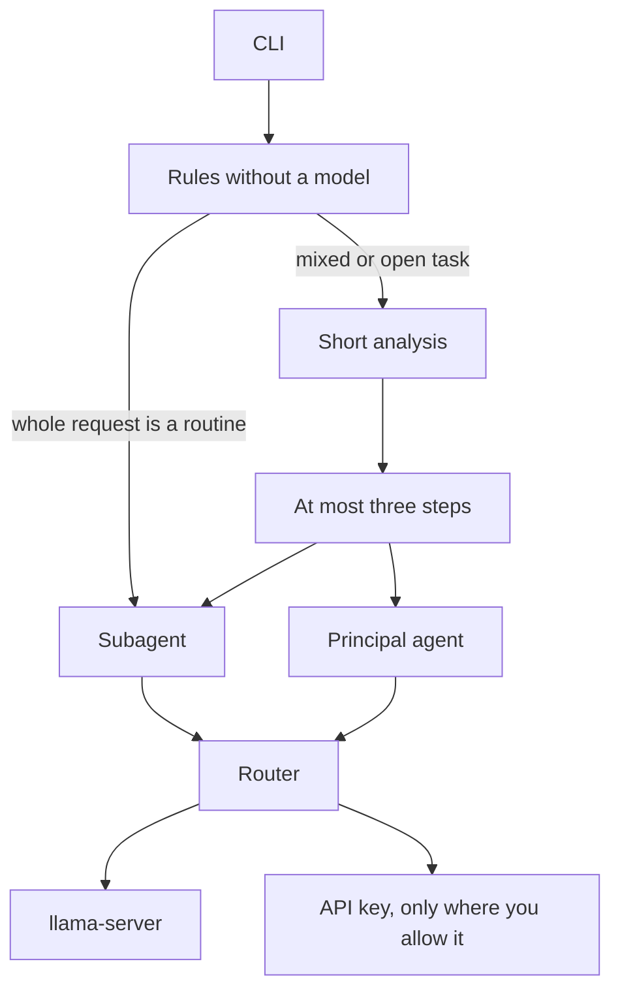

# MultiAgentX

Run tasks from Termux. One Python process takes the request, an orchestrator decides what the work actually needs, and the cheapest worker that can finish each part does it.

A link summary is one fixed routine, not the point of the program. A page is downloaded only when the task needs it.

```text
multiagentx "plan a script that reads a CSV and writes a summary"
multiagentx "compare two ways to validate a form"
multiagentx "resume https://example.com/article"
```

There is no graphical interface and no real browser. The local model is a separate `llama-server` process: it starts for a request and exits after it sits idle, so the phone does not keep the weights in RAM.



## Install on Termux

Install Termux from F-Droid. The Play Store build is out of date.

```bash
pkg update && pkg upgrade -y
pkg install -y python llama-cpp
pip install .
```

Richer article extraction is optional. It needs `libxml2`:

```bash
pip install ".[articles]"
```

Without that extra, the standard-library HTML parser still returns the article text.

Python 3.11 or newer. The only required dependency is `httpx`. No LangChain and no PyTorch.

### Build llama.cpp yourself

If the `llama-cpp` package is missing for your architecture, build the server for aarch64:

```bash
pkg install -y git cmake clang
git clone https://github.com/ggml-org/llama.cpp
cd llama.cpp
cmake -B build
cmake --build build -t llama-server
```

The binary is `build/bin/llama-server`. Put it on `PATH`, or set `local.binary` to its path. Python only talks to the local HTTP API.

## Local model

For a modest phone that still answers in Portuguese, use **Qwen2.5-1.5B-Instruct**, GGUF **Q4_K_M**. Download the file yourself and put its path in the config. The app does not fetch the GGUF.

## Configuration

```bash
multiagentx init
```

This writes `~/.config/multiagentx/config.toml` with mode `600` and no secrets. If an existing file is readable by group or others, the app warns on stderr and does not print the file.

```toml
[local]
model_path = "/path/to/qwen2.5-1.5b-instruct-q4_k_m.gguf"
binary = "llama-server"
port = 18080
context = 2048
idle_seconds = 120

[routing]
remote_provider = "anthropic"   # openrouter or anthropic
remote_scope = "local"          # local, tudo, orquestrador, or principal

[openrouter]
base_url = "https://openrouter.ai/api/v1"
model = ""                      # paste an OpenRouter id, for example a Nemotron

[anthropic]
base_url = "https://api.anthropic.com"
model = ""                      # paste the Claude model id
```

There is no remote model slug in the code. You copy the id into the config.

`remote_scope` is where that one key is allowed to run:

| Scope | Who uses the key |
| --- | --- |
| `local` | Nobody. This is the default, even if a key is present. |
| `tudo` | Orchestrator, routines, and the principal. `llama-server` stays off for that request. |
| `orquestrador` | Only the analysis that splits the task. Everything else stays on the phone. |
| `principal` | Only the principal agent. Analysis stays local, or falls back to rules. |

Keys come from `OPENROUTER_API_KEY`, `ANTHROPIC_API_KEY`, or `api_key` in the matching section. An environment variable wins over the file. Keys are not written to logs or error text.

Point `MULTIAGENTX_CONFIG` at another file when you need one.

## How a task is split

The orchestrator does not answer you. It splits the task so the heavier model only sees what a routine cannot finish.

1. If the whole message is already a routine, no model is spent on routing. A bare `http(s)` URL, or a request that only asks for a summary, goes to `summarize_url`. Define, translate, and rewrite go to `quick_answer`.
2. A mixed or open task gets one short analysis, at most 80 tokens. Up to three steps. Routines run first. The principal, if needed, is last and receives the routine output instead of redoing the fetch or the summary.
3. With scope `orquestrador` or `tudo`, that analysis uses the API key. With `local` or `principal`, it uses the local model. If the orchestrator has no model, keyword rules choose the path and no other key is spent on the decision.

`/engenheiro` followed by the task skips analysis and sends the whole task to the principal.

The server you start listens only on `127.0.0.1`. Before it loads the model, MultiAgentX reads `MemAvailable` from `/proc/meminfo` and refuses to start below 700 MB. Threads are half the cores, capped at 2. If `termux-battery-status` exists and the battery is under 20% while unplugged, it drops to 1 thread and a context of 1024. The process runs at low priority. After 120 seconds without use it is stopped. One generation runs at a time.

Page downloads stop at 2 MB, time out, and reject URLs that resolve to private or link-local addresses.

## Chat

With no arguments, `multiagentx` opens a session. History lasts only for that session, and replies stream as they are generated. `/sair` or Ctrl-D quits and stops the server.

The slash commands are in Portuguese, matching the on-device prompts. Replies follow the language of your message.

```text
/modelo
/modelo local
/modelo claude tudo
/modelo claude orquestrador
/modelo claude principal
/modelo openrouter principal
/engenheiro review this function and say what is missing
```

`/modelo` changes the session only. It does not rewrite the config. Alone, it prints the current pair and never the key.

If a summary routine has neither a local model nor a key, you still get the extracted text plus the reason. Other tasks stop with the reason instead of pretending the work was done.

## Not in this version

A real browser for pages that need JavaScript, a graphical interface, memory across sessions, and more than one local model at a time.
