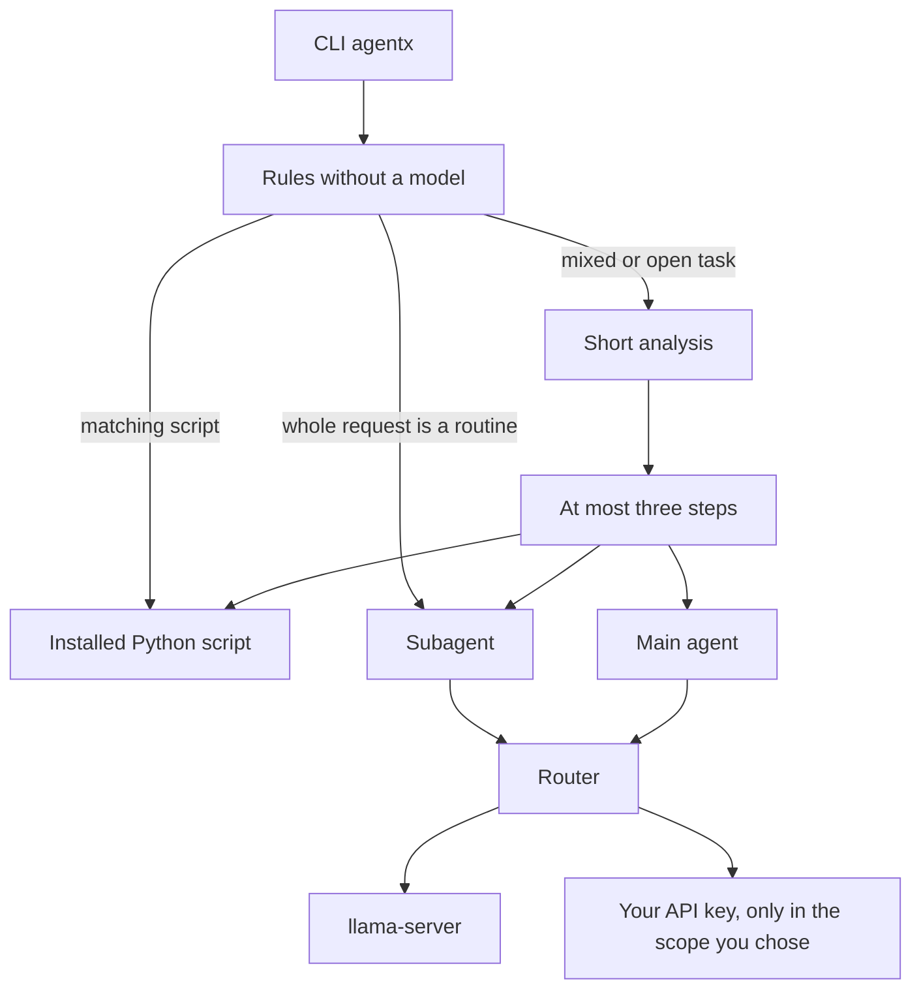

# MultiAgentX

Run tasks from Termux. One Python process takes the request. An orchestrator decides what the work needs, then hands each part to the cheapest worker that can finish it.

This is a task runner. A page is fetched only when the task needs that text.

## Changes

The command is `agentx`. The old `multiagentx` command is gone. `agentx init` writes `~/.config/agentx/config.toml`, and installed scripts live in `~/.config/agentx/scripts`. Running init again keeps that file and the scripts folder.

- **Phone scripts.** Drop a Python file in that scripts folder, run `agentx script examples`, or install a community script with `agentx script install toast`. A public gist works too. Phrases and regular expressions in the script docstring match the request, so the wording does not have to be the keyword. A clear match runs that file and does not spend a model call.
- **Heat.** CPU thermal zones slow the local model at 70 C and pause generation at 85 C.
- **JavaScript pages.** `summarize_url` still starts with a plain download. If the page is empty or only a script shell, an optional browser extra can render it once. Without that extra, you get the static text and a short note, not a made-up summary.
- **OpenAI.** `OPENAI_API_KEY` is a provider next to OpenRouter and Anthropic. Set `remote_provider = "openai"` and choose the scope with `/model openai main`, `/model openai all`, or `/model openai orchestrator`.
- **Saved preferences.** `/model` writes the scope, provider, and model id into the config. `/key`, or `agentx key`, stores a provider key and does not print it. `/language` stores `en` or `pt-BR`. The next launch restores them. `agentx init` does not replace an existing config or delete the scripts folder.
- **Folder context.** One task can read a single matching folder, add a short excerpt to that turn, and drop the excerpt when the turn ends.
- **Language.** Answer text follows the saved language. Commands, tool lines, and errors stay English.

```text
agentx "plan a script that reads a CSV and writes a summary"
agentx "compare two ways to validate a form"
agentx "write a shell function that backs up a directory"
```

There is no graphical interface. The local model is a separate `llama-server` process. It starts for a request and exits after it sits idle, so the phone does not keep the weights in RAM.



## Install on Termux

Install Termux from F-Droid. The Play Store build is out of date.

```bash
pkg update && pkg upgrade -y
pkg install -y python llama-cpp
pip install .
```

Python 3.11 or newer. The only required dependency is `httpx`. No LangChain and no PyTorch. Script-rendered pages can use the optional `browser` extra. That extra is not part of the base install.

### Build llama.cpp yourself

If the `llama-cpp` package is missing for your architecture, build the server for aarch64:

```bash
pkg install -y git cmake clang
git clone https://github.com/ggml-org/llama.cpp
cd llama.cpp
cmake -B build
cmake --build build -t llama-server
```

The binary is `build/bin/llama-server`. Put it on `PATH`, or set `local.binary` to its path. Python only talks to the local HTTP API.

## Local model

For a modest phone, use **Qwen2.5-1.5B-Instruct**, GGUF **Q4_K_M**. Download the file yourself and put its path in the config. The app does not fetch the GGUF.

## Configuration

```bash
agentx init
```

This writes `~/.config/agentx/config.toml` with mode `600` and no secrets. If an existing file is readable by group or others, the app warns on stderr and does not print the file.

```toml
[local]
model_path = "/path/to/qwen2.5-1.5b-instruct-q4_k_m.gguf"
binary = "llama-server"
port = 18080
context = 2048
idle_seconds = 120

[routing]
remote_provider = "openrouter"   # openrouter, anthropic, or openai
remote_scope = "local"           # local, all, orchestrator, or main

[openrouter]
base_url = "https://openrouter.ai/api/v1"
model = ""                       # any model id from that provider

[anthropic]
base_url = "https://api.anthropic.com"
model = ""

[openai]
base_url = "https://api.openai.com/v1"
model = ""
```

The remote model id stays in the config. There is no fixed slug in the code. Each provider calls whichever model its key can use. The commands below do not pick a vendor. They only choose where the configured key is allowed to run.

| Scope | Where the key is used |
| --- | --- |
| `local` | Nowhere. This is the default, even when a key is present. |
| `all` | Orchestrator, routines, and the main agent. `llama-server` stays off for that request. |
| `orchestrator` | Only the analysis that splits the task. Everything else stays on the phone. |
| `main` | Only the main agent. Analysis stays local, or falls back to rules. |

Keys come from `OPENROUTER_API_KEY`, `ANTHROPIC_API_KEY`, `OPENAI_API_KEY`, or `api_key` in the matching section. An environment variable wins over the file. Keys are not written to logs or error text. `/key anthropic` followed by the key, or `agentx key anthropic`, stores it in that section and does not print it. The file stays mode `600` on POSIX.

Point `MULTIAGENTX_CONFIG` at another file when you need one.

## Saved preferences

`/model` updates the current session and writes the same choice into `config.toml`. `/model local`, `/model all`, `/model orchestrator`, and `/model main` save the scope. `/model openai main` also saves the provider. `/model openai gpt-4o-mini` saves that provider and model id. The next `agentx` process reads them back.

`/language` prints `en` or `pt-BR`. `/language en` and `/language pt-BR` switch the answer language and save it. `pt` and `pt_BR` are stored as `pt-BR`. An unknown value prints an error and leaves the file unchanged. Answer text uses "Answer in English." or "Answer in Brazilian Portuguese." Commands, script ids, tool lines, and errors stay English.

`agentx init` creates the config only when it is missing. A second run prints that the file already exists and does not touch the scripts directory.

```toml
[preferences]
language = "en"

[context]
dir = ""
```

`context.dir` is an optional extra root for an explicit path in a task. Leave it empty to use the working directory and the scripts directory only.

## Mobile scripts

Put a Python file in `~/.config/agentx/scripts` when a task should run on the phone instead of going to a model. The orchestrator reads the docstring and runs the one script that matches the request. It does not run a file outside that directory.

```bash
agentx script examples
agentx script list
agentx script add my_task.py
agentx script install toast
agentx script install https://gist.github.com/owner/gistid
```

`script examples` copies three Termux helpers that ship with agentx: a toast, a notification, and a battery reading. They call `termux-toast`, `termux-notification`, and `termux-battery-status`.

`script install NAME` reads a community index and saves that one Python file. The default index is the script list in this repository. A public gist URL, or `gist:ID`, installs the Python file from that gist. If the gist has several Python files, add the file name. Install only saves the file. It does not run it. Downloads stay on HTTPS, reject private addresses, and accept only GitHub hosts plus the host of your index. Set `scripts.index_url` when you want a different community index.

A script needs a docstring with `keywords`, `patterns`, or both. The file name is the id the orchestrator uses. A pattern is a phrase or a regular expression. Words in a phrase may have a few words between them, so `manda aviso` matches `manda um aviso` and `me notifica` matches `me notifica de que o backup acabou`. That match does not call a model.

```python
"""Save a note on the phone.

keywords: note, reminder
patterns: anota isso, save a note, lembra de
"""
```

The task text is the first argument. Print the result to stdout. In chat, `/scripts` lists what is installed. A request such as `show a toast that the backup finished` runs `toast` and does not spend a model call when that script is the clear match.

## On-demand folder context

Some tasks need the text of one folder. agentx chooses that folder for the current turn, reads only the files inside it, and adds a short excerpt to the prompt that answers the task. The excerpt is dropped when the turn ends. It is not written to the config, a cache, or the session.

The folder is chosen in this order, and the search stops at the first hit:

1. An explicit path in the message, when that path stays inside the working directory, the scripts directory, or `context.dir`. A path that escapes those roots is not read. That includes `..` and a symlink whose target is outside.
2. An installed script whose id or keyword matches a word in the message, such as backup. Only that script file is included, unless the same name is a subdirectory.
3. A child directory of the working directory or of the scripts directory whose name matches a word in the message.

If nothing matches, the task runs as usual and no excerpt is added. agentx does not walk the home directory or the rest of the disk, and it does not call an embedding model.

At most 12 files are included. Each file contributes at most 8 KB. The whole excerpt stays within 6000 characters. Binary files are skipped, as are secrets such as `.env`, key files, and credentials. Python and other text files are kept.

`analyze` and `analyse` ask the model to read that folder. They do not run the script. The Portuguese spelling of analyze, without an accent, is treated the same way.

## How a task is split

The orchestrator does not answer you. It splits the task so a larger model only sees what a routine cannot finish.

1. If the whole message is already a routine, no model is spent on routing. A bare `http(s)` URL, or a request that only asks for a summary, goes to `summarize_url`. Define, translate, and rewrite go to `quick_answer`. A request that clearly names one installed script goes to `run_script`.
2. A mixed or open task gets one short analysis, at most 80 tokens and three steps. Routines run first. The main agent, if needed, is last and receives the routine output instead of redoing the fetch or the summary.
3. With scope `orchestrator` or `all`, that analysis uses your remote key. With `local` or `main`, it uses the local model. If the orchestrator has no model, keyword rules choose the path. Another key is not spent just to decide.

`/engineer` followed by the task skips analysis and sends the whole task to the main agent.

The server you start listens only on `127.0.0.1`. Before it loads the model, agentx reads `MemAvailable` from `/proc/meminfo` and refuses to start below 700 MB. Threads are half the cores, capped at 2. If `termux-battery-status` exists and the battery is under 20% while unplugged, it drops to 1 thread and a context of 1024. It also reads CPU thermal zones under `/sys/class/thermal`. At 70 C it uses that same lighter limit. At 85 C it pauses generation until the phone cools down. If the sensors cannot be read, heat is ignored. The process runs at low priority. After 120 seconds without use it is stopped. One generation runs at a time.

Page downloads stop at 2 MB, time out, and reject URLs that resolve to private or link-local addresses. That static download is the default for `summarize_url`.

## JavaScript pages

`summarize_url` reads a page with a plain HTTP download. That path does not run JavaScript and does not start a browser. Most static articles finish there.

If the extract is empty, or the page is only a script shell such as a `noscript` message or an empty app root, and the optional browser extra is installed, the same URL is rendered once. Rendering repeats the URL checks: `http` or `https` only, no username or password, no private or link-local address, and each redirect is checked again. The render uses the same timeout and size cap.

```bash
pip install 'agentx[browser]'
```

Install a browser runtime yourself if you want rendering. MultiAgentX does not download one and does not shell out to install one. On Termux a desktop browser often is not available. In that case, or when the extra is missing, you get the static text and a short note that the page looks script-rendered. That note is not a summary.

This fallback is only for `summarize_url`. It is not a graphical browser, and other tasks do not start it.

## Chat

With no arguments, `agentx` opens a session. History lasts only for that session, and replies stream as they are generated. `/exit` or Ctrl-D quits and stops the server.

The default answer language is English. `/language pt-BR` asks the model to answer in Brazilian Portuguese. Commands, errors, and tool lines stay English.

```text
/model
/model local
/model all
/model orchestrator
/model main
/language
/language en
/language pt-BR
/key anthropic
/engineer review this function and say what is missing
/scripts
```

`/model` updates the session and writes the same choice into the config. Alone, it prints the current scope and the configured provider, and never the key.

`/model all` uses whichever remote key is already in the config. To pick a provider, name it: `/model openrouter main`, `/model anthropic all`, or `/model openai orchestrator`. `/model openai gpt-4o-mini` saves that model id.

If the chosen model cannot run, the task stops with the reason instead of pretending the work was done.

## Not in this version

A graphical interface, a saved chat transcript, and more than one local model at a time.
