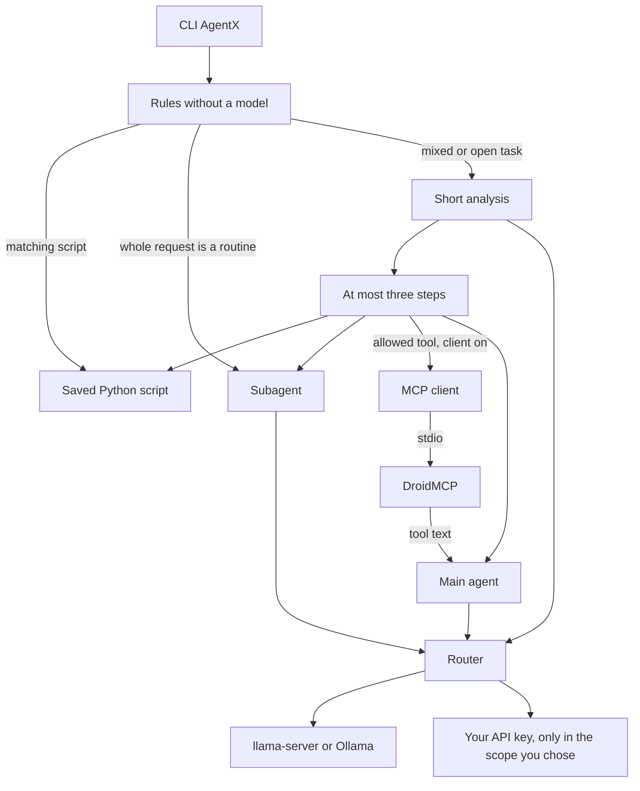

# AgentX

AgentX runs one task from the terminal. It can use a saved Python script, a local model, or a remote API. It does not start a pile of agents for a single request.

```text
$ agentx "show a toast that the backup finished"
Toast shown.
```

That line comes from the `toast` script after `agentx script examples`. The script calls `termux-toast` when that command is installed. No benchmark numbers are published yet.

## Start here

You need Python 3.11 or newer. Termux is the setup this was built for. The same package also runs on any machine with that Python.

```bash
pip install .
agentx init
agentx doctor
agentx script examples
agentx "show a toast that the backup finished"
```

A local model is optional. Use `llama-server` with a GGUF file, or Ollama at `127.0.0.1:11434`. On Termux, `agentx init` can ask before it downloads Qwen2.5-1.5B-Instruct Q4_K_M into `~/ollama/models`. The file is kept only when it is about 1.0G. Start `llama-server` on `127.0.0.1:8080` in one terminal, then run `agentx` in another. If that server is already up, AgentX uses it.

When you type `agentx` in a terminal, it asks whether you want llama-server. Yes prints the command for the other terminal. No saves Ollama in the config and tells you to run `ollama serve`.

A remote key is optional. OpenRouter, Anthropic, and OpenAI are the choices. Scope `all` does not need a local file.

JavaScript pages need an optional extra: `pip install 'agentx[browser]'`. AgentX does not download a browser.

DroidMCP is optional and stays a separate project. On Termux, after the local model is installed, `agentx init` can ask before it downloads the sensors binary from the pinned DroidMCP release and checks the checksum. Location, shell, SMS, contacts, and GitHub stay off. AgentX does not vendor DroidMCP and does not listen as an MCP server. With the client off, tasks still use scripts, local models, and remote APIs. No combined RAM or latency numbers are published yet.

## What changed

The command is `agentx`. The old `multiagentx` command is gone. `agentx init` writes `~/.config/agentx/config.toml`. Saved scripts live in `~/.config/agentx/scripts`. Running init again keeps that file and that folder.

You can drop a Python file in the scripts folder, create one with `agentx script new NAME`, install the included set with `agentx script examples`, or install a community script with `agentx script install toast`. A public gist works too. Phrases in the script docstring match the request, so the wording does not have to be the keyword. A clear match runs that file and does not spend a model call. If two scripts match equally, AgentX names them and waits for you to pick one.

CPU thermal zones slow the local model at 70 C and pause generation at 85 C.

`summarize_url` starts with a plain download. If the page is empty or only a script shell, the optional browser extra can render it once. Without that extra, you get the static text and a short note, not a made-up summary.

`OPENAI_API_KEY` sits next to OpenRouter and Anthropic. Set `remote_provider = "openai"` and choose the scope with `/model openai main`, `/model openai all`, or `/model openai orchestrator`.

`/model` writes the scope, provider, and model id into the config. `/key`, or `agentx key`, stores a provider key and does not print it. `/language` stores `en` or `pt-BR`. `pt` is stored as `pt-BR`. The next launch restores them. `agentx init` does not replace an existing config or delete the scripts folder.

One task can read a single matching folder, add a short excerpt to that turn, and drop the excerpt when the turn ends.

`/language en`, `/language pt`, or `/language pt-BR` changes the menus, the help guide, errors, and the model answers. Typed commands such as `/model` and `agentx doctor` stay the same words.

OpenRouter, OpenAI, and Anthropic model ids are free strings. A slug such as `meta-llama/llama-3.2-3b-instruct:free` is saved and sent as written, including the `:free` suffix. A 404 means that provider rejected the id. AgentX does not keep a fixed list.

`[local] provider = "ollama"` talks to a local Ollama server on loopback instead of starting llama-server. Set `local.model`, or run `/model ollama qwen2.5:1.5b`. AgentX does not download or pull the model. llama-server remains the default until you say no at the startup question.

Each of `[openrouter]`, `[anthropic]`, and `[openai]` has an editable `max_tokens` (default 1024). Long remote replies use that cap. Orchestrator analysis stays at 80 tokens, and `quick_answer` keeps its small cap. If a stream stops because it hit the limit, the reply ends with `The reply reached the token limit.` AgentX does not spend a second paid call to continue.

`agentx doctor` checks the config file (`MULTIAGENTX_CONFIG` or `~/.config/agentx/config.toml`). A missing file or broken TOML fails with a line number. It never prints keys, never starts llama-server, and never calls a remote API.

AgentX can speak stdio MCP to one external DroidMCP binary. The projects stay separate. There is no HTTP listener and no MCP server inside AgentX. The process starts only when a task asks for an allowed tool. It stops before a local model runs, so the two are not in memory together. It also stops when you return to the menu or quit. A one-shot command stops it when that command ends. `agentx mcp tools` lists names and exits. Only names in `mcp.tools` can be called. Command names are refused. An empty list calls nothing. A missing binary does not stop the rest of the task. Combined RAM and latency have not been measured.

```toml
[local]
provider = "ollama"
model = "qwen2.5:1.5b"
base_url = "http://127.0.0.1:11434"
```

```text
agentx "plan a script that reads a CSV and writes a summary"
agentx "compare two ways to validate a form"
agentx "create a script called note that saves a short note"
agentx "run script note remember the milk"
```

There is no graphical interface. The default local model is a separate `llama-server` process. It starts for a request and exits after it sits idle, so the weights are not kept in memory. With `[local] provider = "ollama"`, AgentX does not start llama-server and talks to Ollama on loopback instead.



A matching script, a new starter script, and a routine that already covers the whole request do not start DroidMCP. The MCP client runs only after the short analysis, and only when that plan names a tool from `mcp.tools`. The tool text comes back to the main agent. The process stops before that model runs, and nothing is left running when you return to the menu or quit. DroidMCP itself does not call the router.

## Install on Termux

Install Termux from F-Droid. The Play Store build is out of date.

```bash
pkg update && pkg upgrade -y
pkg install -y python git dos2unix
git clone https://github.com/JoaoPHS/AgentX
cd AgentX
dos2unix iniciar.sh
chmod +x iniciar.sh
./iniciar.sh
```

`iniciar.sh` uses Unix line endings and the Termux bash path. A Windows clone can still arrive with CRLF, so `dos2unix` is the step that avoids `bad interpreter: No such file or directory`. The starter asks Termux for storage access when that command exists, installs this folder so `agentx` is this clone, then runs `python -m agentx init`. After that, start the app with `agentx`.

If a script later needs the phone storage or the network, run `termux-setup-storage` once.

Python 3.11 or newer. The only required dependency is `httpx`. There is no LangChain and no PyTorch. Script-rendered pages can use the optional `browser` extra. That extra is not part of the base install.

### Build llama.cpp yourself

If the `llama-cpp` package is missing for your architecture, build the server for aarch64:

```bash
pkg install -y git cmake clang
git clone https://github.com/ggml-org/llama.cpp
cd llama.cpp
cmake -B build
cmake --build build -t llama-server
```

The binary is `build/bin/llama-server`. Put it on `PATH`, or set `local.binary` to its path. Python only talks to the local HTTP API.

## Local model

When memory is limited, use **Qwen2.5-1.5B-Instruct**, GGUF **Q4_K_M**. Download the file yourself and put its path in the config. The app does not fetch the GGUF on its own, except for the optional Termux question in `agentx init`.

To use Ollama instead, install and start Ollama yourself, pull a model with `ollama pull`, then set `[local] provider = "ollama"` and `local.model` to that name. Saying no at the `agentx` startup question saves the same fields. `/model ollama qwen2.5:1.5b` does too. AgentX does not run `ollama pull`. The Ollama URL must be `127.0.0.1` or `localhost`.

## Configuration

```bash
agentx init
```

This writes `~/.config/agentx/config.toml` with mode `600` and no secrets. If an existing file is readable by the group or by others, the app warns on stderr and does not print the file.

```toml
[local]
provider = "llama"               # llama or ollama
model_path = "/path/to/qwen2.5-1.5b-instruct-q4_k_m.gguf"
model = ""                       # Ollama name, e.g. qwen2.5:1.5b
binary = "llama-server"
base_url = "http://127.0.0.1:11434"
port = 18080
context = 2048
idle_seconds = 120

[routing]
remote_provider = "openrouter"   # openrouter, anthropic, or openai
remote_scope = "local"           # local, all, orchestrator, or main

[openrouter]
base_url = "https://openrouter.ai/api/v1"
model = ""                       # any model id from that provider, including :free slugs
max_tokens = 1024

[anthropic]
base_url = "https://api.anthropic.com"
model = ""
max_tokens = 1024

[openai]
base_url = "https://api.openai.com/v1"
model = ""
max_tokens = 1024
```

The remote model id stays in the config. There is no fixed slug in the code. Each provider calls whichever model its key can use, including OpenRouter free ids that end in `:free`. If the remote API returns 404, AgentX reports that the API did not accept that id. The commands below do not pick a vendor. They only choose where the configured key is allowed to run.

| Scope | Where the key is used |
| --- | --- |
| `local` | Nowhere. This is the default, even when a key is present. |
| `all` | Orchestrator, routines, and the main agent. `llama-server` stays off for that request. |
| `orchestrator` | Only the analysis that splits the task. Everything else stays local. |
| `main` | Only the main agent. Analysis stays local, or falls back to rules. |

Keys come from `OPENROUTER_API_KEY`, `ANTHROPIC_API_KEY`, `OPENAI_API_KEY`, or `api_key` in the matching section. An environment variable wins over the file. Keys are not written to logs or error text. `/key anthropic` followed by the key, or `agentx key anthropic`, stores it in that section and does not print it. The file stays mode `600` on POSIX.

Point `MULTIAGENTX_CONFIG` at another file when you need one.

`agentx doctor` reads that file and prints one OK, FAIL, or WARN line per check. Exit 0 means nothing failed. A missing file tells you to run `agentx init`. Broken TOML names the line.

```text
agentx doctor
Config file: OK
TOML: OK
remote_scope: OK
remote_provider: OK
local.model_path: OK
```

## Saved preferences

`/model` updates the current session and writes the same choice into `config.toml`. `/model local`, `/model all`, `/model orchestrator`, and `/model main` save the scope. `/model openai main` also saves the provider. `/model openai gpt-4o-mini` saves that provider and model id. `/model ollama qwen2.5:1.5b` saves the local Ollama provider and name. It is not a remote cloud provider. The next AgentX process reads them back.

`/language` prints `en` or `pt-BR`. `/language en`, `/language pt`, and `/language pt-BR` switch the interface and the answer language, then save that choice. `pt` and `pt_BR` are stored as `pt-BR`. An unknown value prints an error and leaves the file unchanged. Answer text uses "Answer in English." or "Answer in Brazilian Portuguese." Menus, the help guide, and errors follow the same choice. Typed commands stay as written.

`agentx init` creates the config only when it is missing. A second run prints that the file already exists and does not touch the scripts directory.

```toml
[preferences]
language = "en"

[context]
dir = ""
```

`context.dir` is an optional extra root for an explicit path in a task. Leave it empty to use the working directory and the scripts directory only.

## Scripts

Saved scripts live in `~/.config/agentx/scripts`. The orchestrator reads the docstring and runs the one script that matches the request. It does not run a file outside that directory.

```bash
agentx script new note "Save a short note"
agentx script run note "remember the milk"
agentx script examples
agentx script list
agentx script add my_task.py
agentx script install toast
agentx script install https://gist.github.com/owner/gistid
```

`script new` writes a small Python file with a docstring, a keyword, and a `main` function. Edit that file when you want real behavior. `script run` executes the saved file and passes the rest of the line as the task text.

You can also say it in chat:

```text
create a script called note that saves a short note
run script note remember the milk
list scripts
```

A condition such as `but`, `if`, `don't`, or `não` does not create or run a script.

`script examples` copies the 50 included scripts: toast, notification, battery, and smaller checks and text helpers. Those same files are stored in the `scripts` folder of this repository. A clear phrase runs one of them without a model call.

`script install NAME` reads a community index and can save that one Python file. The default index is the script list in this repository. A public gist URL, or `gist:ID`, offers the Python file from that gist. If the gist has several Python files, add the file name. Before anything is written, AgentX prints the source URL, the SHA-256, and a reminder that installing does not mean the script is safe. Confirm with `y` at a terminal, or pass `--yes`. Without one of those, the file is not saved. Install does not run the script. Downloads stay on HTTPS, reject private addresses, and accept only GitHub hosts plus the host of your index. Set `scripts.index_url` when you want a different community index.

A script needs a docstring with `keywords`, `patterns`, or both. The file name is the id the orchestrator uses. A pattern is a phrase or a regular expression. Words in a phrase may have a few words between them, so `send a notice` matches `send a short notice` and `notify me` matches `notify me that the backup finished`. That match does not call a model.

```python
"""Save a short note.

keywords: note, reminder
patterns: write this down, save a note, remind me
"""
```

The task text is the first argument. Print the result to stdout. In chat, `/scripts` lists what is saved. A request such as `show a toast that the backup finished` runs `toast` and does not spend a model call when that script is the clear match.

The Scripts menu can create a script, run one, list them, install the included set, or install a community script.

## Folder context for one turn

Some tasks need the text of one folder. AgentX chooses that folder for the current turn, reads only the files inside it, and adds a short excerpt to the prompt that answers the task. The excerpt is dropped when the turn ends. It is not written to the config, a cache, or the session.

The folder is chosen in this order, and the search stops at the first hit:

1. An explicit path in the message, when that path stays inside the working directory, the scripts directory, or `context.dir`. A path that escapes those roots is not read. That includes `..` and a symlink whose target is outside.
2. A saved script whose id or keyword matches a word in the message, such as backup. Only that script file is included, unless the same name is a subdirectory.
3. A child directory of the working directory or of the scripts directory whose name matches a word in the message.

If nothing matches, the task runs as usual and no excerpt is added. AgentX does not walk the home directory or the rest of the disk, and it does not call an embedding model.

At most 12 files are included. Each file contributes at most 8 KB. The whole excerpt stays within 6000 characters. Binary files are skipped, as are secrets such as `.env`, key files, and credentials. Python and other text files are kept.

`analyze` and `analyse` ask the model to read that folder. They do not run the script.

## How a task is split

The orchestrator does not answer you. It splits the task so a larger model only sees what a routine cannot finish.

1. If the whole message is already a routine, no model is spent on routing. `run script NAME` runs that saved file. `create a script called NAME` stores a starter file. `list scripts` prints what is saved. A bare `http(s)` URL, or a request that only asks for a summary, goes to `summarize_url`. Define, translate, rewrite, and a short "what is" go to `quick_answer`, in English or Portuguese. A request that clearly names one saved script goes to `run_script`. These paths do not start DroidMCP. A condition or a refusal, such as `but`, `if`, `not`, or `don't`, does not run or save a script. On scope `all` or `main`, that ambiguous request is not sent to the remote key by a weak rule. If two scripts match equally, AgentX lists the names instead of guessing.
2. A mixed or open task gets one short analysis, at most 80 tokens and three steps. The analysis sees every saved script id and may name one of them. It cannot invent an id. Routines run first. This analysis is the only place that can add a DroidMCP step, and only for a name listed in `mcp.tools` while the client is on. The main agent, if needed, is last and receives the routine output and the tool text instead of redoing the fetch, the summary, or the tool call.
3. With scope `orchestrator` or `all`, that analysis uses your remote key. With `local` or `main`, it uses the local model. If the orchestrator has no model, keyword rules choose the path. Another key is not spent just to decide.

`/engineer` followed by the task skips analysis and sends the whole task to the main agent.

The llama-server process listens only on `127.0.0.1`. Before it loads the model, AgentX reads `MemAvailable` from `/proc/meminfo` and refuses to start below 700 MB. Threads are half the cores, capped at 2. If `termux-battery-status` exists and the battery is under 20% while unplugged, it drops to 1 thread and a context of 1024. It also reads CPU thermal zones under `/sys/class/thermal`. At 70 C it uses that same lighter limit. At 85 C it pauses generation until the device cools down. If the sensors cannot be read, heat is ignored. The process runs at low priority. After 120 seconds without use it is stopped. One generation runs at a time. Ollama uses the same 700 MB and 85 C checks and does not start llama-server.

Page downloads stop at 2 MB, time out, and reject URLs that resolve to private or link-local addresses. That static download is the default for `summarize_url`.

## JavaScript pages

`summarize_url` reads a page with a plain HTTP download. That path does not run JavaScript and does not start a browser. Most static articles finish there.

If the extract is empty, or the page is only a script shell such as a `noscript` message or an empty app root, and the optional browser extra is installed, the same URL is rendered once. Rendering repeats the URL checks: `http` or `https` only, no username or password, no private or link-local address, and each redirect is checked again. The render uses the same timeout and size cap.

```bash
pip install 'agentx[browser]'
```

Install a browser runtime yourself if you want rendering. AgentX does not download one and does not shell out to install one. On Termux a desktop browser often is not available. In that case, or when the extra is missing, you get the static text and a short note that the page looks script-rendered. That note is not a summary.

This fallback is only for `summarize_url`. It is not a graphical browser, and other tasks do not start it.

## Chat

With no arguments in a terminal, `agentx` first asks about llama-server, then opens a cyan home menu. Arrow keys move, Enter selects, and `q` goes back. The pages are Chat, Scripts, Configuration, Help guide, and Check config. The Help guide explains what AgentX is, what it is for, commands, scripts, API keys, DroidMCP, running locally, llama-server, and `ollama serve`. `agentx help` prints the same pages. While a task is running, the terminal shows `thinking`, then `thinking.`, `thinking..`, and `thinking...` in a loop until the answer starts. `/menu` returns to the home menu. Outside a terminal, `agentx` keeps the plain `>` prompt and does not ask about the engine.

The saved language starts as English. `/language pt` or `/language pt-BR` switches the menus, the help guide, errors, and the model answers to Brazilian Portuguese. Typed commands such as `/model` stay as written.

```text
/model
/model local
/model all
/model orchestrator
/model main
/model ollama qwen2.5:1.5b
/language
/language en
/language pt-BR
/key anthropic
/engineer review this function and say what is missing
/scripts
/menu
```

`/model` updates the session and writes the same choice into the config. Alone, it prints the current scope and the configured provider, and never the key.

`/model all` uses whichever remote key is already in the config. To pick a provider, name it: `/model openrouter main`, `/model anthropic all`, or `/model openai orchestrator`. `/model openai gpt-4o-mini` saves that model id. `/model openrouter meta-llama/llama-3.2-3b-instruct:free` saves that exact string. `/model ollama qwen2.5:1.5b` points the local engine at Ollama.

If the chosen model cannot run, the task stops with the reason instead of pretending the work was done.

## Not in this version

A graphical interface, a saved chat transcript, and more than one local model at a time.
